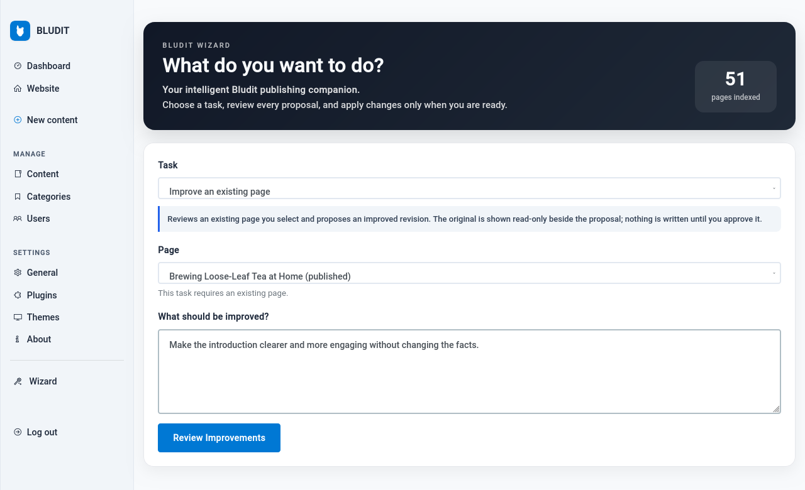
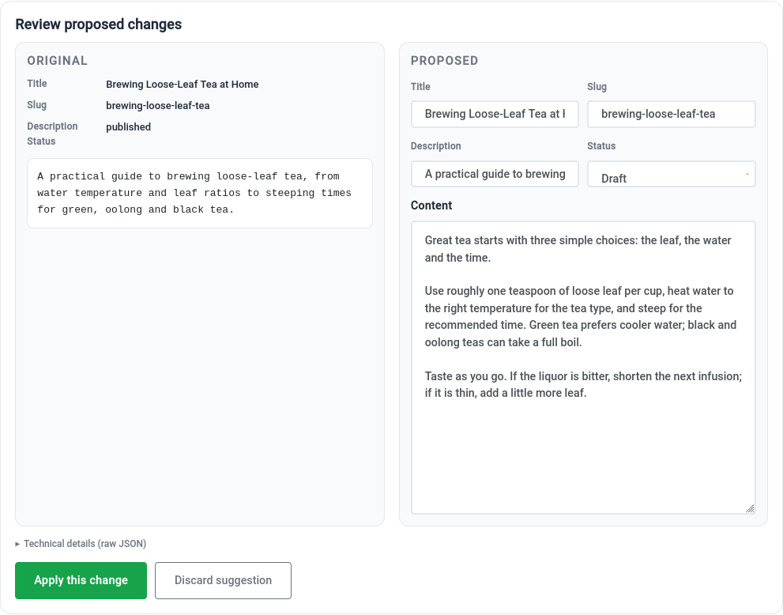
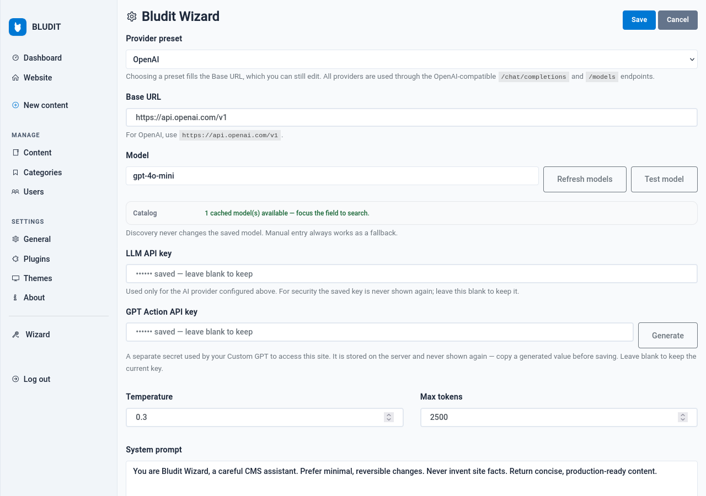

# Bludit Wizard


**AI-assisted writing, editing, SEO analysis, and content management for Bludit CMS — twelve guided tasks with human-reviewed changes.**

[](LICENSE)
[](https://www.bludit.com/)
[](https://www.php.net/)

Bludit Wizard is a native Bludit plugin. It connects the admin area to a
configurable OpenAI-compatible AI provider and guides you through focused
writing, editing, SEO and analysis workflows. Generated content is always shown
for review: nothing is written to a page until you explicitly approve it, and
analysis tasks never modify content.

The plugin is designed for a human publisher. It is not an autonomous site
manager and does not publish anything unattended.

## Screenshots

| Wizard workspace | Review before applying |
| --- | --- |
|  |  |



## Features

### Write & Create

1. **Create a New Page** — Generate a complete new page or article draft from
   instructions you supply. Review the generated content before saving or
   publishing. **Primary action: Generate Draft.**
2. **Create an Outline** — Generate a structured outline for an article, blog
   post, or other content. **Primary action: Generate Outline.**
3. **Generate Article Ideas** — Brainstorm content topics, article concepts, and
   potential writing directions. **Primary action: Generate Ideas.**

### Edit & Improve

All four tasks require you to select an existing Bludit page.

4. **Improve an Existing Page** — Analyze existing content and propose
   improvements to its quality, organization, and clarity. **Primary action:
   Review Improvements.**
5. **Rewrite Tone or Style** — Rewrite an existing page in the requested voice,
   tone, or writing style. **Primary action: Rewrite Content.**
6. **Expand or Shorten Content** — Adjust the length of an existing page while
   retaining its intended meaning. **Primary action: Adjust Length.**
7. **Proofread Content** — Identify and correct grammar, spelling, punctuation,
   wording, and clarity problems. **Primary action: Proofread Page.**

### SEO & Quality

All four tasks require you to select an existing Bludit page.

8. **SEO + Clarity Audit** — Analyze a page for search optimization,
   readability, clarity, and content organization. **Primary action: Analyze
   Page.**
9. **Generate SEO Metadata** — Generate suggested SEO titles, descriptions, and
   supported metadata for an existing page. **Primary action: Generate
   Metadata.**
10. **Suggest Internal Links** — Identify useful internal linking opportunities
    based on other relevant pages on the same Bludit site. Suggested targets are
    checked against the real page index. **Primary action: Find Link
    Opportunities.**
11. **Audit Content Freshness** — Review content for outdated information,
    information that may need verification, and opportunities for updating.
    **Primary action: Check Content Freshness.**

### Ask Wizard

12. **Ask Wizard** — Ask questions about writing, the website, or supported
    Bludit functionality. Optionally select an existing page to provide relevant
    context. This task does not modify site content. **Primary action: Ask
    Wizard.**

### Additional capabilities

- Task-specific instructions, guidance, placeholders and controls.
- Existing-page selection for every task that needs it.
- Configurable OpenAI-compatible providers and models.
- Searchable model discovery with optional free-model and tool-support filters.
- Connection and inference testing for the configured model.
- Context-aware assistance with strict isolation between tasks and pages.
- Human review before changes, with original/proposed comparison.
- Draft and metadata proposal workflows.
- Read-only SEO, internal-link and freshness analysis.
- Markdown result copying.
- Security-focused API communication.

## Requirements

- **Bludit 3.22.x** — tested with Bludit Community 3.22.0 and Bludit Pro 3.22.0.
- **PHP 8.0 or newer** — tested with PHP 8.2.
- PHP extensions: `curl`, `mbstring`, `json` (bundled with PHP). HTTPS provider
  endpoints also need working CA certificates.
- Administrator access to the Bludit admin area.
- An API key and base URL for an OpenAI-compatible provider, or a reachable
  local/self-hosted endpoint.

The plugin has no Composer dependencies and no external runtime service.

## Installation

1. Download `bludit-wizard-1.1.0.zip` from the
   [latest release](https://github.com/gitdamnit/bludit-wizard/releases/latest).
2. Extract the archive. It contains a single `wizard/` directory.
3. Upload that directory to `bl-plugins/` so the path is
   `bl-plugins/wizard/plugin.php`.
4. In Bludit, open **Settings → Plugins** and activate **Bludit Wizard**.
5. Open **Settings → Plugins → Bludit Wizard** to configure the provider.
6. Choose a provider preset or enter an OpenAI-compatible **Base URL**.
7. Enter the model id, or use **Refresh Models** to retrieve the provider's
   catalog and select one.
8. Enter the provider **LLM API key** and save.
9. Use **Test Model** to confirm the endpoint, authentication and inference.
10. Open **Wizard** in the admin sidebar, choose a task, select a page when
    required, and provide your instructions.

### Upgrading

Replace the **entire** `bl-plugins/wizard/` directory with the new release. Do
not copy only `plugin.php`: the JavaScript, CSS, `lib/netpolicy.php` and
`assets.json` must all come from the same release. Settings and keys live in
`bl-content/databases/plugins/wizard/db.php` and are preserved.

After upgrading, purge any site/CDN cache and hard-refresh once. Asset URLs carry
the release version (for example `wizard.js?v=1.1.0`) so a cached old script
cannot silently break the interface.

## Supported AI providers

Bludit Wizard supports configurable OpenAI-compatible AI providers, including
OpenAI, OpenRouter, LLM Gateway, and compatible Ollama deployments. OpenRouter
and LLM Gateway model discovery, filtering, and connection testing have been
verified in live use. Other providers and models may work depending on API
compatibility, authentication, capabilities, and network accessibility.

### Tested in live use

- **OpenRouter** — provider configuration, model discovery, model selection,
  model testing, free-model filtering, and task execution.
- **LLM Gateway** — provider configuration, model discovery, model selection,
  model testing, free-model filtering, and task execution.

### OpenAI

OpenAI is supported through its OpenAI-compatible API. Use the API base URL
provided by OpenAI (for example `https://api.openai.com/v1`), a model your
account can access, and an API key. The maintainer's live acceptance testing
covered OpenRouter and LLM Gateway; OpenAI compatibility is by API design.

### Ollama and self-hosted endpoints

Ollama exposes an OpenAI-compatible API (commonly
`http://127.0.0.1:11434/v1`). The Ollama service must be reachable **from the
server that runs Bludit**.

- A remote hosting installation cannot ordinarily reach an Ollama instance on
  your own computer through `localhost`; that address refers to the hosting
  server itself.
- Private-network destinations are blocked by the plugin's SSRF protections
  unless an administrator explicitly enables private-network providers.
- Do not expose an unauthenticated Ollama instance directly to the public
  internet. Use a secure, explicitly supported network configuration.

The SSRF and private-network protections are not weakened to accommodate a local
provider.

### Other providers

Services that implement sufficiently compatible `/chat/completions` and
`/models` endpoints may work. This is compatibility by API design, not
individually verified support. A model returned by a provider is not a guarantee
that it supports every task or every optional parameter.

## Model discovery and testing

- **Refresh Models** calls the provider's `/models` endpoint and caches the
  catalog. The saved model is not changed.
- The catalog is searchable. Select a model or keep typing a model id manually;
  manual entry always works as a fallback.
- **Free models only** and **Tool support only** filters appear when the
  provider supplies the metadata needed for them. Some providers omit that
  metadata, so the filters may be hidden or incomplete.
- **Test Model** verifies URL validity, network reachability, authentication and
  a minimal inference request. A successful test confirms that the endpoint and
  credentials work for that request; it does not prove that every task or every
  advanced parameter works with that model.

## How it works

1. **Select a task** — writing, editing, SEO/quality analysis, or Ask Wizard.
2. **Provide instructions** — and select an existing page when the task needs
   one.
3. **Generate** a proposal or analysis.
4. **Review** the result. Editable tasks show the original page beside the
   proposed content.
5. **Apply only when authorized** — press **Apply this change** to save an
   editable proposal. Read-only audits have no Apply action.

Switching task or page clears the previous selection, result and approval state,
so content from one page cannot be applied to another.

## Human approval and safety

- **Explicit approval:** no generated content is written until you press
  **Apply this change**.
- **Read-only analysis:** SEO + clarity, internal links and freshness audits
  never modify pages.
- **Stale-edit protection:** a proposal is pinned to the page revision it was
  generated from. If the page changes in another tab, the write is refused.
- **Revision check:** applying to an existing page requires the matching
  revision; a missing or stale revision is rejected.
- **API credential protection:** saved LLM and GPT Action keys are never echoed
  back into the admin page. Blank submissions keep the stored keys.
- **SSRF safeguards:** provider URLs are validated; private and restricted
  destinations are blocked unless explicitly allowed; cloud metadata endpoints
  are always refused.
- **Request safety:** CSRF validation, administrator authorization for provider
  actions, escaped output, and safe Markdown rendering are enforced.
- **No page deletion:** Bludit Wizard has no deletion action. Use Bludit's
  Content screen to delete pages.

## Troubleshooting

| Symptom | Likely cause / fix |
| --- | --- |
| No models returned by **Refresh Models** | Check the Base URL, provider key and network access. Some providers require a different `/models` path or do not expose a catalog; enter the model id manually. |
| A model fails tasks | The model may not support the required request shape, context length or parameters. Try a model the provider documents for chat completions. |
| Provider authentication failure | Re-enter the LLM API key. Saved keys are never displayed; leave the field blank to keep the current key only when it is already correct. |
| Incorrect Base URL | Use the provider's OpenAI-compatible base URL ending in `/v1`, not a dashboard or chat page URL. |
| “The Wizard interface did not finish loading” | The browser is running a missing, blocked or stale script. Purge the site/CDN cache, confirm `wizard.js?v=…` returns HTTP 200, and reload. |
| Page selector does not appear | Confirm the complete release was uploaded (especially `js/wizard.js` and `assets.json`) and that the asset URL includes the current version. |
| Old interface after upgrading | The old plugin directory or a cache is still being served. Replace the whole `wizard/` directory, purge caches and hard-refresh. |
| “Wizard unavailable” | The workspace configuration did not load. Re-upload the complete `wizard/` directory and reload. |

For deployment verification, fetch
`https://YOUR-SITE/bl-plugins/wizard/assets.json` and compare its
`files["js/wizard.js"]` SHA-256 with the served file.

## Changelog

### v1.1.0

- Twelve guided content workflows across writing, editing, SEO/quality and
  contextual assistance.
- Expanded writing and editing tools: tone/style rewriting, length adjustment,
  proofreading, SEO metadata, internal-link suggestions and content-freshness
  auditing.
- Task-specific page selection, instructions and primary action labels.
- Full-width workspace with original/proposed review and explicit approval.
- Configurable OpenAI-compatible providers, searchable model discovery and
  model testing.
- Stability corrections following the 1.1.0 release candidate: reliable form
  dispatch, server-rendered page selection, safe degraded-JavaScript handling
  and versioned assets.

See [wizard/CHANGELOG.md](wizard/CHANGELOG.md) for the complete history.

## Development

The repository includes an isolated Docker test harness:

```bash
testenv/fetch-upstream.sh
docker compose -f testenv/compose.yaml up -d --build
tests/run-all.sh local
```

Requirements: Docker, Node.js 20+, and PHP 8.2 for the network-policy unit
tests. The AI provider used by the tests is a deterministic local mock; no real
API keys are required. Browser tests use Playwright.

## License

Bludit Wizard is licensed under the **GNU General Public License, version 3
only** (SPDX: `GPL-3.0-only`). See [LICENSE](LICENSE).

Copyright © 2026 Evan Zellner ([@gitdamnit](https://github.com/gitdamnit)).

See [docs/LICENSING.md](docs/LICENSING.md) for the third-party audit and the
source of the official license text. Bludit itself is a separate project with its own license; this plugin does not
alter or redistribute Bludit.

## Contributing

Issues and pull requests are welcome at
[gitdamnit/bludit-wizard](https://github.com/gitdamnit/bludit-wizard). Please:

- describe the Bludit and PHP versions you tested;
- include the provider and model only when relevant (never include API keys);
- run the test suite and include the result when changing runtime code;
- keep changes focused and preserve the human-approval safety model.

Do not include secrets, private site content or production credentials in issues,
screenshots or pull requests.
